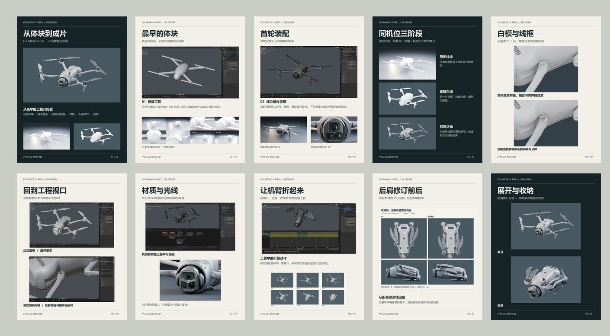

# DJI Mavic 4 Pro · 从体块到成片

依据公开资料重建的 Blender 产品 CG 项目。以预演工程与首轮装配样张为起点，记录白模、网格、材质、折叠动作与最终渲染。后肩轴线依据公开图推断，尺寸偏差见完整包内的装配复验记录。

[下载完整制作档案](https://github.com/AJ-nb/3d-asset-archive/releases/download/mavic-4-pro-process-v1/Mavic-4-Pro-Process-Full.zip) · [下载 10 张小红书发布图](https://github.com/AJ-nb/3d-asset-archive/releases/download/mavic-4-pro-process-v1/Mavic-4-Pro-XHS-10-PNG.zip) · [发帖文案](小红书发布文案.md) · [SHA-256](SHA256SUMS)

## 按制作顺序看

| 阶段 | 可直接打开的原图 |
| --- | --- |
| 预演、首轮装配 | [01-预演体块](blender-ui/01-预演体块.png) · [02-首轮装配](blender-ui/02-首轮装配.png) |
| 白模与后肩局部网格 | [03-正式白模](blender-ui/03-正式白模.png) · [04-后肩编辑网格](blender-ui/04-后肩编辑网格.png) |
| 折叠动作与材质节点 | [05-折叠机构与动作](blender-ui/05-折叠机构与动作.png) · [06-机壳材质节点](blender-ui/06-机壳材质节点.png) |
| 体块、白模与材质成片 | [01-基础体块-补绘](renders-4k/01-基础体块-补绘.png) · [02-白模-补绘](renders-4k/02-白模-补绘.png) · [03-材质灯光-4K补渲](renders-4k/03-材质灯光-4K补渲.png) |
| 完整图文 | [按编号浏览 10 张 1440 × 1920 发布图](post/) |

六张 Blender 整窗图均为重新打开已保存工程后截取，原图为 2560 × 1369。三张 3840 × 2160 流程图为同机位 Cycles 原生补渲，其中体块来自早期工程，白模与材质成片来自后肩修订定稿。此次核查的旧原创效果图最高为 3000 × 1900。[截图索引](records/工程截图索引.csv) · [历史 4K 核查](records/历史4K核查.csv)

## 完整制作档案

解压完整 ZIP，打开根目录的 **打开看图.html** 即可离线浏览。文件夹内保留原有相对路径。

| 文件夹 | 内容 |
| --- | --- |
| 历史效果图 | 72 张效果图、44 张白模及结构检视图、31 张过程图、4 份 EXR。内附可按版本筛选的图册。 |
| 源工程与记录 | 9 个可编辑 Blender 工程、历史预演分镜、装配修订与截面记录。 |
| 工程界面、流程渲染 | 6 张界面截图、3 张 4K 图及其来源与复验资料。 |
| 动画原片 | V1 展开演示、V6 产品短片与修订版折叠演示。 |
| 小红书发布图 | 编号 01–10 的竖版 PNG，根目录另附文案、总览和逐图溯源表。 |

[完整包逐文件清单](records/完整档案文件表.csv) · [历版原图索引](records/历版原图索引.csv) · [发布图源](records/发帖图源.csv) · [工程回读结果](records/工程打开复验.json) · [发布页](https://github.com/AJ-nb/3d-asset-archive/releases/tag/mavic-4-pro-process-v1)
