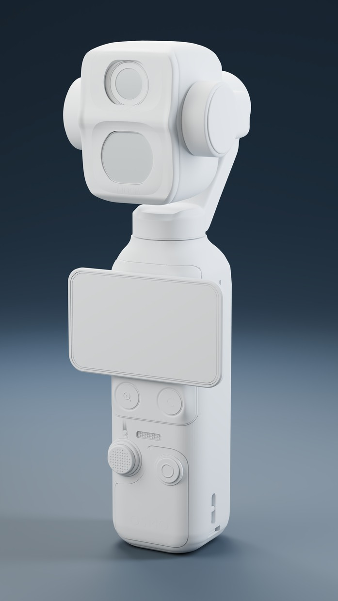

# 4K 渲染图

点预览打开 JPG，点「原图」下载对应原生 PNG。全部原图也收录于[完整证据包](https://github.com/AJ-nb/3d-asset-archive/releases/download/pocket-process-v1/Pocket-Process-Full.zip)。

## V7 自建终版 · 同机位补渲

第 62 帧，88 mm 主视觉。白模、线框与成品使用相同投影，均为 2160 × 3840、16 位 RGB PNG。

| 图 | 预览 | 下载 |
| --- | --- | --- |
| 整机白模 | [预览](previews/4k/v7-clay.jpg) | [原图](https://github.com/AJ-nb/3d-asset-archive/releases/download/pocket-process-v1/v7-4k-01-clay.png) |
| 真实可见边线 | [预览](previews/4k/v7-wire.jpg) | [原图](https://github.com/AJ-nb/3d-asset-archive/releases/download/pocket-process-v1/v7-4k-02-wire.png) |
| 材质成品 | [预览](previews/4k/v7-beauty.jpg) | [原图](https://github.com/AJ-nb/3d-asset-archive/releases/download/pocket-process-v1/v7-4k-03-beauty.png) |

## 前作 · 11 张历史 4K

配色工程使用当时提供的第三方几何。保留经典黑、珍珠白与白模的棚拍原图。

| 配色与机位 | 原始像素 | 预览 | 下载 |
| --- | --- | --- | --- |
| 经典黑 · 主视觉 | 2160 × 3840 | [预览](previews/4k/classic-black-01-hero.jpg) | [原图](https://github.com/AJ-nb/3d-asset-archive/releases/download/pocket-process-v1/historical-classic-black-01-hero.png) |
| 经典黑 · 背面 | 2160 × 3840 | [预览](previews/4k/classic-black-02-rear.jpg) | [原图](https://github.com/AJ-nb/3d-asset-archive/releases/download/pocket-process-v1/historical-classic-black-02-rear.png) |
| 经典黑 · 镜头 | 3840 × 2160 | [预览](previews/4k/classic-black-03-optics.jpg) | [原图](https://github.com/AJ-nb/3d-asset-archive/releases/download/pocket-process-v1/historical-classic-black-03-optics.png) |
| 经典黑 · 操控区 | 2160 × 3840 | [预览](previews/4k/classic-black-04-controls.jpg) | [原图](https://github.com/AJ-nb/3d-asset-archive/releases/download/pocket-process-v1/historical-classic-black-04-controls.png) |
| 珍珠白 · 主视觉 | 2160 × 3840 | [预览](previews/4k/pearl-white-01-hero.jpg) | [原图](https://github.com/AJ-nb/3d-asset-archive/releases/download/pocket-process-v1/historical-pearl-white-01-hero.png) |
| 珍珠白 · 背面 | 2160 × 3840 | [预览](previews/4k/pearl-white-02-rear.jpg) | [原图](https://github.com/AJ-nb/3d-asset-archive/releases/download/pocket-process-v1/historical-pearl-white-02-rear.png) |
| 珍珠白 · 镜头 | 3840 × 2160 | [预览](previews/4k/pearl-white-03-optics.jpg) | [原图](https://github.com/AJ-nb/3d-asset-archive/releases/download/pocket-process-v1/historical-pearl-white-03-optics.png) |
| 珍珠白 · 操控区 | 2160 × 3840 | [预览](previews/4k/pearl-white-04-controls.jpg) | [原图](https://github.com/AJ-nb/3d-asset-archive/releases/download/pocket-process-v1/historical-pearl-white-04-controls.png) |
| 白模 · 主视觉 | 2160 × 3840 | [预览](previews/4k/white-clay-01-hero.jpg) | [原图](https://github.com/AJ-nb/3d-asset-archive/releases/download/pocket-process-v1/historical-white-clay-01-hero.png) |
| 白模 · 背面 | 2160 × 3840 | [预览](previews/4k/white-clay-02-rear.jpg) | [原图](https://github.com/AJ-nb/3d-asset-archive/releases/download/pocket-process-v1/historical-white-clay-02-rear.png) |
| 白模 · 侧面 | 2160 × 3840 | [预览](previews/4k/white-clay-06-profile.jpg) | [原图](https://github.com/AJ-nb/3d-asset-archive/releases/download/pocket-process-v1/historical-white-clay-06-profile.png) |
