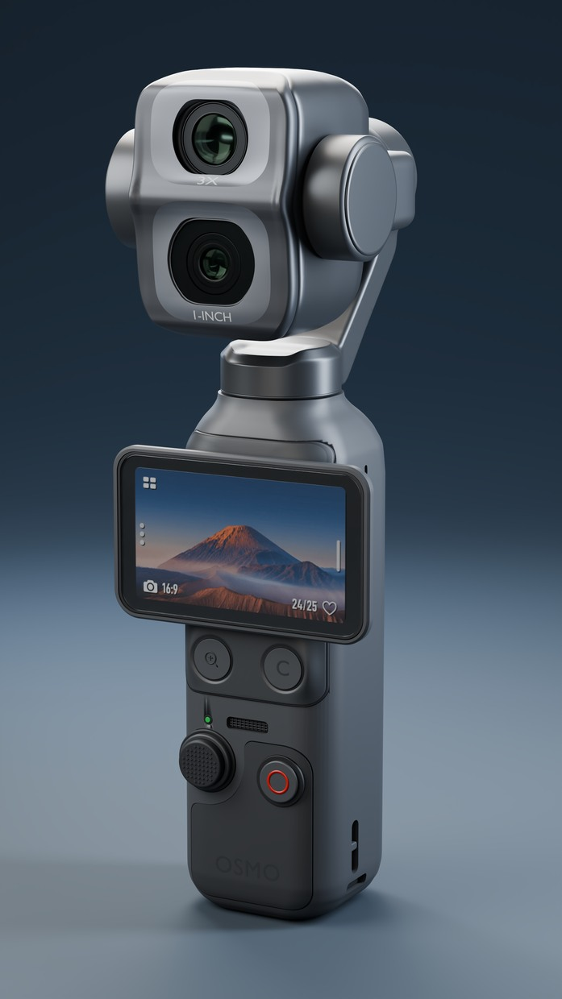

# 口袋云台相机 · Blender 制作归档

从空场景到白模、结构修复、材质灯光和 15 秒 CG。完整包保留可编辑工程、原分辨率渲染、工程界面截图、过程原片与离线图册。

[浏览全部 363 个归档文件](FILES.md) · [下载 V7 终版 .blend](files/06_自建工程与成片/dji-osmo-pocket-4p-v7/Portable-DJI-Osmo-Pocket-4P-V7-Final.blend?raw=1) · [下载 15 秒 CG 工程 .blend](files/06_自建工程与成片/dji-osmo-pocket-4p-cg15/Portable-Pulse-15s.blend?raw=1) · [下载成片 MP4](files/06_自建工程与成片/dji-osmo-pocket-4p-cg15/Pulse-15s.mp4?raw=1)

| 查看 | 内容 |
| --- | --- |
| [18 个 Blender 文件及配套素材](FILES.md#工程与动画) | V1 至 V7 和动画工程的原始文件与可携副本，另附已有的贴图、音频和脚本。 |
| [桌面支撑独立试作](desk-support-trial/) | 两种支撑方案的[可编辑白模](desk-support-trial/desk-study.blend?raw=1)、设计访谈、机位与动作干涉复查。 |
| [4K 渲染图](4K.md) | 历史 11 张原图，外加 V7 自建终版同机位白模、线框及成品三张。可逐张下载。 |
| [历版渲染图](%E5%8E%86%E7%89%88%E6%B8%B2%E6%9F%93%E5%9B%BE.md) | V1–V7 原始成品与历史预览的文件索引。 |
| [制作过程与工程截图](%E5%88%B6%E4%BD%9C%E8%BF%87%E7%A8%8B.md) | V1 起模复演、26 张过程原片、8 张 Blender 工程截图与成片。 |
| [小红书发布图](xiaohongshu/) | 9 张可直接使用的发布长图和文案。 |
| [来源与校验](evidence/) | 原图、工程、镜头、截图及包内文件的 SHA-256 清单。 |

## 下载

- [完整证据包](https://github.com/AJ-nb/3d-asset-archive/releases/download/pocket-process-v1/Pocket-Process-Full.zip)。解压后打开「开始阅读.html」，点击缩略图查看原图。编辑 Blender 时从「06_自建工程与成片」进入。
- [离线补充包](https://github.com/AJ-nb/3d-asset-archive/releases/download/pocket-process-v1/Pocket-Process-Supplement.zip)。与完整包解压到同一目录，用于打开六个离线截面查看器和检查 V7 复拍资源。
- [小红书发布包](https://github.com/AJ-nb/3d-asset-archive/releases/download/pocket-process-v1/Pocket-Xiaohongshu.zip)。9 张 JPG 与发布文案。
- [Release 全部附件](https://github.com/AJ-nb/3d-asset-archive/releases/tag/pocket-process-v1)。

前作棚拍采用当时提供的第三方几何。自建主线以 V1 起模。V3 保留当时的原始反馈截图，最早三个建模节点由原脚本复演，V7 同机位三联为归档时补渲。参考照片及屏内风景来自 DJI 商店。

