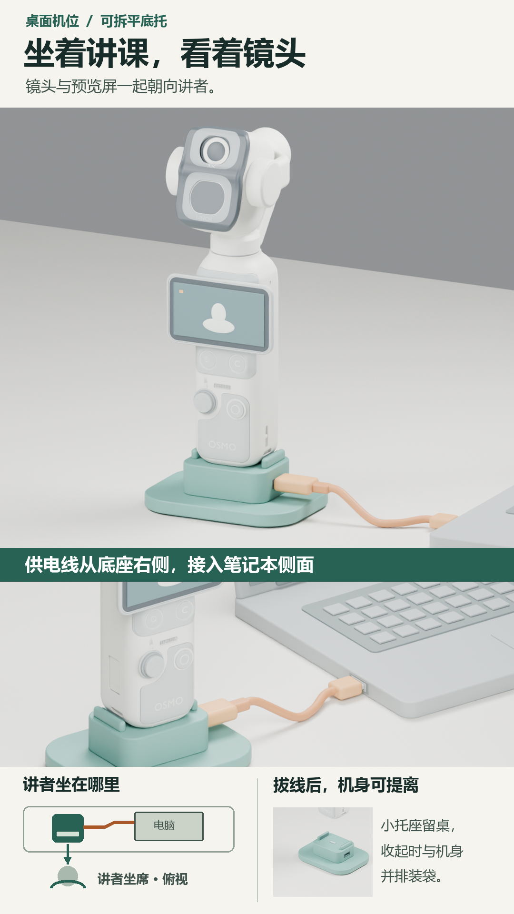
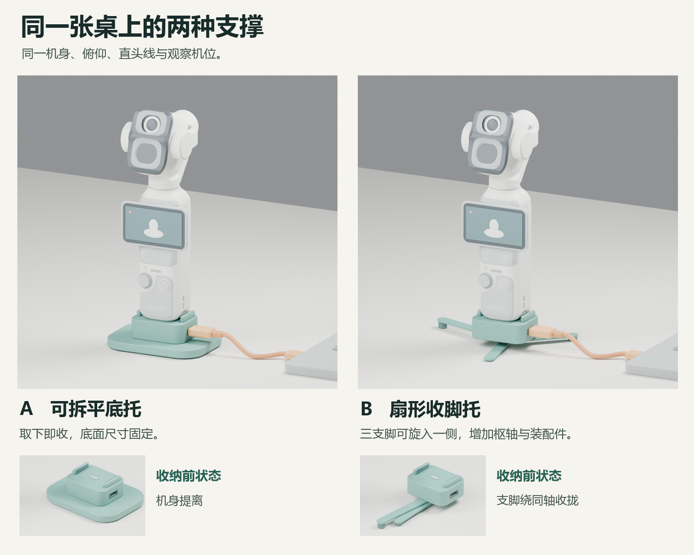

# DJI 口袋云台相机 · 讲课桌面支撑试用

一位老师想把手持云台相机放到书桌上，坐着看预览、录讲解，并用右手边的电脑持续供电。第一轮要交两种桌面支撑的对照、一张手机上能读懂的竖图，以及可以继续改的白模。

本次用档案中的 DJI 相机造型代替客户来件。独立执行的 AI 设计师从早期粗模图和已有 V7 工程起步，另一角色模拟委托人回答问题。附件是本次原创的配件设计研究，型号兼容、真实用户偏好与样机表现仍待实测。[原始相机档案](../) · [产品 CG 工作室](../../../skills/product-cg-studio/)

[12 个实际访谈问题、参考产品及方案取舍](interview.md) · [作为来件使用的早期粗模图](../../../skills/product-cg-studio/examples/concept/dji-pocket-v1-body.jpg)

| 手机讲解图 · 1080 × 1920 | 同任务、同相机的两种白模 |
| --- | --- |
| [](phone.png) | [](directions.png) |

## 设计决定

| 决定 | 来自哪项约束 | 如何验证 |
| --- | --- | --- |
| 保留机身外壳和原操作件，两案都从底部接入，再把外部线引到讲者右侧 | 现有 V7 工程的充电口在机底。客户角色提出右侧走线和直头线 | 核对底部端口、支撑面与转接件的相对位置，再从桌面机位检查接线和取放。真实端子、电气连接与公差仍需样件 |
| A 使用可拆平底托，作为本轮主图方案 | 桌面录制优先，客户角色允许底座留在桌上或和机身分开收纳 | 查看就位和竖直提离两个状态。抗侧拉、长期固定效果待实体测试 |
| B 使用可拆的三片扇形支脚 | 在相同桌面、相同机身上比较另一种收纳方式 | 查看展开与收拢姿态，逐件检查旋转轴和支脚。枢轴、限位与脚垫需按制造方案另行核验 |
| 屏幕使用原创的人像几何标识 | 竖图需要交代预览朝向 | 在目标宽度读取人像、镜头、坐席和底座。实际屏幕亮度、坐姿视线及真人取景仍待验证 |

## 折脚在哪里撞到了，后来怎样修

初稿整体图里看不出碰撞。把 B 方案从展开逐帧收到并拢时，第 107、108、110 帧在不同支脚之间检出四组表面相交，涉及脚片与脚垫、脚垫与脚垫。调整 B 的支脚长度和折回角度后，按同样的对象对重查第 94–110 帧，17 个整数帧的相交记录为空。A 方案另从第 62 帧查到第 94 帧，机身两个壳件与四块导向件在 33 个整数帧中均未检出表面相交。[首稿相交的帧和部件](intersections-before.json) · [定稿测量结果](qa.json)

| 支撑件在水平桌面上的数字包络 | X × Y |
| --- | --- |
| A 平底托，就位 | 77.00 × 59.00 mm |
| B 三支脚，展开 | 107.75 × 82.21 mm |
| B 三支脚，收拢途中第 102 帧 | 110.75 × 61.34 mm |
| B 三支脚，收拢 | 43.00 × 86.33 mm |

这些长度来自白模。中途的 X 向占位比展开态还宽，摆在电脑旁时要给转动过程留空间。检查覆盖指定配对的网格表面和整数帧。配合公差、曲面间的最小正间隙、连续运动中的所有时刻、桌面抗滑与倾倒仍需另验。

在本项目目录内运行下列命令可用 [audit.py](audit.py) 重算一份结果。换一个新的输出文件名，保留已有的测量记录。

使用 MCP 时，可把本目录设为工作区，把 `desk-study.blend` 和 [fold-checks.json](fold-checks.json) 交给 `audit_assembly`。这份清单覆盖 B 方案三条支脚之间的 12 对网格，从第 94 帧查到第 110 帧。[接入客户端与示例请求](../../../skills/product-cg-studio/mcp/README.md)

```sh
blender -b --factory-startup --disable-autoexec desk-study.blend --python-exit-code 1 -P audit.py -- measured.json
```

## 360 像素宽的手机图复核

第一次让未读简报的 AI 只看[初稿](phone-first.png)。它看出相机由桌面底托支撑、镜头和预览屏朝向讲者，但主图里的橙线在画面右下方消失，只能借俯视图上的「电脑」推断终点。

第二轮把笔记本侧面的接收口和插头做进模型，增设独立近景，在同一幅里保留电线两端和可辨认的键盘。一位未看过初稿的 AI 在 360 像素宽的复核图里正确指出底座右侧和电脑侧边两个端点。随后放宽整机镜头，为云台顶部保留裁切余量。供电用途依靠文案说明，实际充电、物理稳定性、真人读图和客户签收仍待验证。

## 在 Blender 中复查

打开 [desk-study.blend](desk-study.blend)。场景 `A - Lift-out desk dock` 和 `B - Detachable fan-foot dock` 共用机身、桌面和主机位。第 62 帧看使用状态，第 94 帧看机身提离，第 110 帧看 B 的支脚收拢。可以直接选择支脚、轴、底座和接线组件检查或修改。

本工程保留 155 个可分别编辑的相机网格，以及本次新增的俯仰、拔线、提离与折脚动作。需要修改原机完整云台绑定时，请使用[V7 终版可携工程 .blend](../files/06_%E8%87%AA%E5%BB%BA%E5%B7%A5%E7%A8%8B%E4%B8%8E%E6%88%90%E7%89%87/dji-osmo-pocket-4p-v7/Portable-DJI-Osmo-Pocket-4P-V7-Final.blend?raw=1)。本轮手机图里的屏幕、电脑与线材都在场景中建立，重开检查列有零张图像、零个链接库和零条外部资源路径。

镜头、机位、关键帧和输出像素见 [shots.json](shots.json)。在仓库根目录运行以下命令可重出镜头。每次选择新的输出目录，Blender 未加入 PATH 时给两条命令追加 `--blender` 和可执行程序路径。

```sh
python skills/product-cg-studio/scripts/render_batch.py check projects/pocket-camera/desk-support-trial/shots.json
python skills/product-cg-studio/scripts/render_batch.py render projects/pocket-camera/desk-support-trial/shots.json --out work/desk-trial
```

安装 Pillow 9.1 或以上版本后，从仓库根目录运行以下命令，即可把这批镜头排成 `phone.png` 和 `directions.png`。如默认中文字体不可用，追加 `--font` 和 `--bold-font` 指定本机有权使用的中文字体文件。

```sh
python projects/pocket-camera/desk-support-trial/compose.py work/desk-trial
```

独立目录重放使用 Windows、Blender 5.2.2 LTS、Cycles、Pillow 13.0.0 及微软雅黑。复出的五个镜头与定稿原片逐像素相同，拼出的两张 PNG 与本目录的交付文件逐字节相同。更换字体时版面字形会随之变化。
