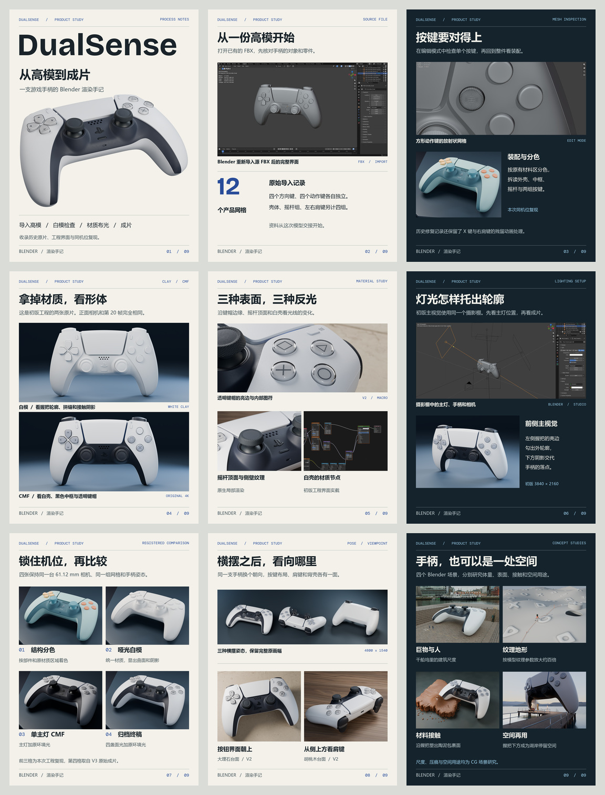

# Sony DualSense · 从高模到成片

从接收第三方 FBX 高模开始记录 Blender 制作流程，包括模型导入与检查、白模、颜色与材料表现、灯光，以及产品原片和尺度概念。原片以实际输出尺寸归档。



| 目录 | 内容 |
| --- | --- |
| [00　来源与工程](00-来源与工程/) | 源 FBX、首次导入工程、9 个历史 Blender 工程，以及搭建脚本、渲染日志和校验记录 |
| [01　历史原图](01-历史原图/) | 51 幅历史画面，含 37 张长边 3840 像素的独立渲染、原生白模、4800 像素宽的横摆组合和 V3 成片。透明通道 EXR 另存 |
| [02　工程界面](02-工程界面/) | 5 张历史原截、8 张本次实截及 2 张历史预览 |
| [03　同机位流程](03-同机位流程/) | 结构分色、哑光白模、CMF 单主灯与归档终稿。前三张为阶段复现，第四张为 V3 原图。附可编辑工程 |
| [04　小红书图组](04-小红书图组/) | 9 张按发布顺序命名的 1440 × 1920 PNG |

[制作流程与证据索引](制作流程与证据索引.md) · [原图索引](01-历史原图/原图索引.csv) · [发布图逐图溯源](小红书逐图溯源.csv) · [原版 4K 评审板](01-历史原图/08-初版评审板/dualsense-4k-review.jpg)

[下载九张发布图 ZIP](https://github.com/AJ-nb/3d-asset-archive/raw/refs/heads/main/projects/sony-dualsense/DualSense-Xiaohongshu.zip) · [小红书发布文案](小红书发布文案.md)

## 下载原图与工程

原片和大文件用 Git LFS 保存。安装 Git LFS 后，克隆仓库，再执行 `git lfs pull`。双击 `projects/sony-dualsense/打开看图.html` 可离线浏览图组及对应原件。在项目目录运行 `sha256sum --check 全包文件校验.sha256` 可核对归档文件。

```sh
git lfs install
git clone https://github.com/AJ-nb/3d-asset-archive.git
cd 3d-asset-archive
git lfs pull
```

需要单个完整归档时，可在下载后将 `projects/sony-dualsense` 整个目录压缩为 ZIP。

截图索引中的三处本机会话路径用文字标记，保留同期记录的行号、截图与日志。归档流程从导入已有高模开始，产品作者从草图到网格的原始建模过程未随模型交付。
