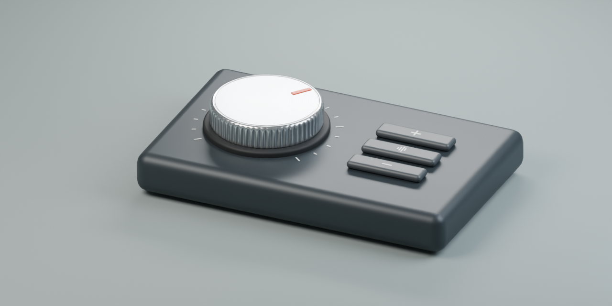

# 产品 CG 工作室 · Product CG Studio

给 AI 制作搭档一份产品简报、一组实拍参考或已有工程，按产品交付可编辑的 Blender 场景、效果图和展示动画。建模、调材质、选镜头和看样片由 AI 配合 Blender 执行。两个命令行工具分别负责整理多产品工单、从已准备好的场景批量出片。



这台控制器有两个可打开的版本。基础场景演示批量静帧与旋钮动画，精修场景演示如何在同一模型上分配新材质、制作细节并为横竖版单独布置机位。[基础场景](examples/demo.blend) · [精修场景](examples/finished/volume-controller.blend) · [旋钮竖幅特写](examples/finished/portrait.png) · [同机位白模小样](examples/finished/clay.png)

## 安装与调用

下载分享包并解压，把完整的 `product-cg-studio` 文件夹复制到 Codex 的技能目录。默认位置为 Windows 的 `%USERPROFILE%\.codex\skills\` 或 macOS／Linux 的 `~/.codex/skills/`。设置过 `CODEX_HOME` 时放进它下面的 `skills/`。安装后应能看到 `skills/product-cg-studio/SKILL.md`。新开一个对话，附上素材或指定工作目录，发送下面任何一种请求。同事使用其他支持本地文件和 Blender 的 AI 工具时，也可以直接指定它阅读 [SKILL.md](SKILL.md) 并执行。

> 使用 $product-cg-studio 接手这个手柄工程，保留原始外形和按钮布局。做一张按键朝上横放的桌面主视觉，另做一张手机竖图，能看清握把的细纹。交付两张原图和可重开的工程。

> 使用 $product-cg-studio 根据这些照片制作带铰链的台灯。先用侧视白模验证连接位置，再做一个展示开合的 6 秒短片。请注明哪些尺寸来自测量、哪些只按照片估计。

> 使用 $product-cg-studio 处理 products.json 里的每款产品。逐款完成建模或修复、出样、精修和交付，汇总可打开的工程、成品、已验项目和缺件。

## 批量怎么跑

准备阶段只需 Python 3。渲染阶段还需要能在本地后台运行的 Blender。此包在 Windows、Blender 5.2.2 LTS、Cycles CPU 下实测。命令中的 `python`、`blender` 可替换为本机程序路径。生成 MP4 时另用 FFmpeg。

| 手里的材料 | 从哪里开始 | 运行后得到什么 |
| --- | --- | --- |
| 多款产品的文字简报、参考图或旧工程 | 复制 [products.json](examples/products.json)，按款改输入、画幅和验收要求，运行下面第一条命令，再交给 AI 执行工作单。 | 每款一份 `brief.md` 和整批状态表。进入 AI 建模和精修阶段。[工单字段与续做](references/production-queue.md) |
| 可渲染的 Blender 工程和命名机位 | 复制 [batch.json](examples/batch.json)，替换工程、场景、相机和帧段，先检查再渲染。 | 分镜头的静帧／PNG 序列和运行报告；可选择失败镜头单独重跑。[批渲染、重试和视频编码](references/batch.md) |

从本技能目录试跑，以下输出目录应使用新名字。

```sh
python scripts/prepare_queue.py examples/products.json --out work/orders-01
python scripts/render_batch.py check examples/batch.json
python scripts/render_batch.py render examples/batch.json --out work/render-01
```

[原创旋钮控制器场景](examples/demo.blend) 随包提供。示例会输出一张整体图和四帧旋钮转动近景。打开 `work/render-01/shots/hero/still.png` 看整体，逐帧看 `shots/turn/` 中的指示线。要从空场景重建，可运行[示例生成脚本](examples/make_demo.py)，用法见批渲染说明。

试做材质与构图精修时，打开 [volume-controller.blend](examples/finished/volume-controller.blend)。这个版本为金属旋钮建立了侧面凹槽与盘面细纹，保留了分件、材质节点和两台相机。下面的命令直接重渲 1280 × 640 的整机横幅和 800 × 1000 的旋钮竖幅。

```sh
python scripts/render_batch.py render examples/finished/shots.json --out work/finished-01
```

要重做精修过程，在新的工作目录生成基础场景，再运行[材质与机位修改脚本](examples/finished/finish.py)。以下命令从技能目录运行，输出 `work/remake/volume-controller.blend` 和该次运行的白模小样。可以把 `examples/finished/shots.json` 复制到新工程旁再渲染。

```sh
blender -b --factory-startup --python-exit-code 1 -P examples/make_demo.py -- work/remake/blockout.blend
blender -b --factory-startup --disable-autoexec work/remake/blockout.blend --python-exit-code 1 -P examples/finished/finish.py
```

## 产品动画示例

同一台控制器还拍了一支 3 秒的双镜头短片。首镜从较低的位置升起，交代整机和底座。第 33 帧切到旋钮特写，机身保持固定，指针跟随旋钮旋转。在 Blender 打开动画工程即可查看摄影机、剪点与产品各自的关键帧。[播放或下载 MP4](examples/film/volume-control.mp4) · [动画工程](examples/film/motion.blend) · [逐镜重渲与编码说明](examples/film/README.md)

## 怎样验收一次试跑

- 工单报告应列出两个可制作的原创简报。可以在清单副本中给其中一款添加不存在的参考图，检查报告是否点名缺件，并继续生成另一款的工单。
- 在渲染清单副本中把一个相机改成不存在的名字。报告应给出那一项的错误及可选机位，另一项仍应出片。修正相机名后，用 `--only` 和新的输出目录复跑该项。
- 查看精修横图中底脚与桌面的接触，以及竖图中旋钮侧槽和盘面细纹。我们在同一台机器上从生成脚本重建了工程，白模、横幅与竖幅的 RGB 像素均与包内定稿一致。换用不同 Blender 版本、引擎或硬件时，按规格与画面对照复核。

## 三个项目怎样改变了流程

| 项目经验 | 复用到下一单的决定 |
| --- | --- |
| DualSense 的已有模型需要修复。桌面横图和手机竖图承担不同的信息，放大后还有肩键印字等细节限制。 | 接单先确定模型来源，保留基准。分别安排产品姿态、拍摄机位和画幅，按最终使用尺寸检查文字、轮廓和贴地阴影。[静帧与 CMF](references/cmf-stills.md) |
| 口袋云台相机历版通过同机位图、装配检查和运动抽帧反复修正；最终竖片有独立的镜头表、工程及成片检查。 | 拍参考与模型的配准图。把产品转动、相机运动和剪点写在同一张分镜表里，分别复核场景中的动作和编码后看到的画面。[建模与动画](references/model-and-motion.md) |
| 折叠无人机的外轮廓、关节的安装方式以及收纳时的运动包络，需要不同证据才能确认。 | 用模型坐标、支承、极限帧和独立视角定位问题。记录照片估计和模型内测量的适用范围，几何修改后重出受影响的镜头。[结构复核](references/model-and-motion.md) |

分享包使用原创示例，运行无需联网下载商业产品模型、字体、HDRI 或插件。
