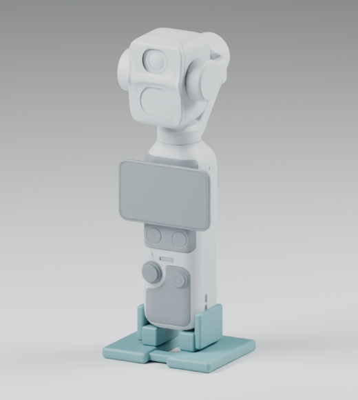
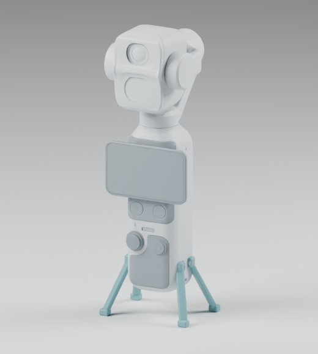
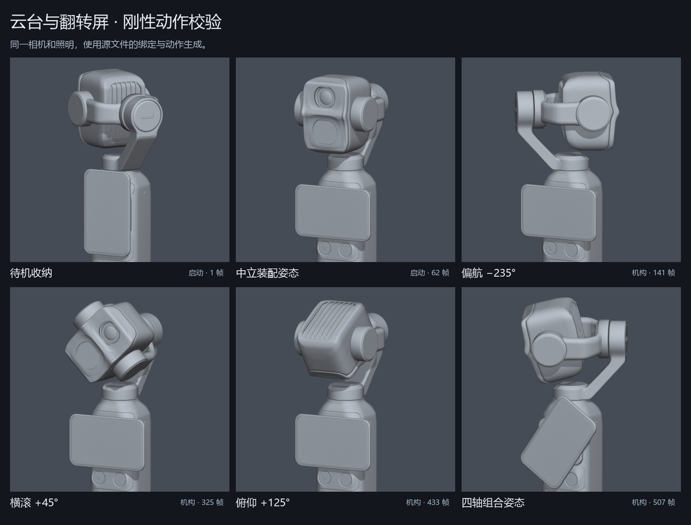

# DJI 口袋云台相机 · 从一句想法到第一版白模

**模拟简报**　“我想做一台能随身带的云台相机。希望有一块能看清取景的屏幕，还没想好是拿在手上用，还是摆在桌上拍。”

下图取自仓库自建的 DJI 口袋云台相机 CG 项目。归档时按 V1 原脚本复演到「机身与横屏组件」，可以看出握把、屏框和按键的位置，头部尚未建立。练习把这张阶段图当作访谈输入。客户简报和后面的回答均为教学模拟。[起模复演记录](https://github.com/AJ-nb/3d-asset-archive/blob/main/projects/pocket-camera/evidence/replay-v1.json)


## 先用什么问题决定下一版

单手行走拍摄时，握感、摇杆位置和拇指能否避开屏幕会改变握把轮廓。放在桌上拍口播时，摄像头朝谁、屏幕从哪里看、充电线如何避开支架更重要。请客户先说一个最常见的拍摄时刻，再圈出阶段图中要保留的部分。已有的横屏外观无法说明转屏轴心与安装方式。

运行[概念工单](products.json)会生成 12 个针对相机的问题。把答复中的方向、原话与仍未知的尺寸记入工单，然后展示[有 DJI 官方来源的参考板](dji-references.md)，请客户按特征选择。只有一句文字输入时可从文字开始，同样适用这套访谈。[访谈方法](../../references/concept-intake.md)

## 把选择落实到装配与画面

> 模拟答复：“主要放在桌上拍我讲话，我选 B。希望坐下就看得到屏幕。桌面支架我会给型号，外壳想要哑光。首图要看得出镜头朝我、屏幕也朝我。”

| 客户的决定或待证事项 | 交给建模、动作与渲染的具体任务 |
| --- | --- |
| **已选 B**，桌面口播 | 先建简化支撑与桌面，按坐姿视线检查取景。用侧视图标注底部接触区、屏中心与镜头中心；待客户提供常用桌高和拍摄距离后再定比例。 |
| **已选** 面向使用者的镜头与可读的屏幕 | 屏幕、机身、支臂与云台头分件，给屏幕和云台分别设轴。记录从收纳到就位的关键帧与中间姿态，逐帧检查最近距离和可见区域。 |
| **待提供** 支架型号 | 接口先保留可编辑的占位体。收到型号和配合尺寸后重查连接、线缆、桌面接触和装拆空间。 |
| **已选** 哑光握把 | 先在中性光里检查机壳倒角、细纹尺度和玻璃反射，再制作桌面主视觉。首图让观众看清镜头、屏幕和着地点。 |

## 在同一个桌面比较两种支撑

客户刚选的是使用场景，底部结构仍有取舍。下面两张白模都使用仓库 DJI 相机 V7 Final 第 62 帧的相同机身，同一水平桌面、正交镜头、照明和画幅。灰色机身保留连贯握把、独立横屏和可辨认的镜头朝向。青灰色支撑是本练习新建的候选件，尺寸由教学草模设定，两案均未经实物配合或稳定性试验。

| B1 · 外接桌面底座 | B2 · 机身内置折脚的展开草案 |
| --- | --- |
|  |  |
| 两条底轨承托握把，中央和背部留出线缆路径。底轨外缘包络为 64 × 52 mm。带走相机时底座可留在桌上，换场地需要另带底座。 | 四个接地脚垫的外缘包络为 58 × 43 mm。随身携带的附件可减少，但下壳要容纳脚片、轴和限位。图中只建了展开态与轴座位置。 |
| 下一轮拿实际配件量承托面、接头与插拔空间；从桌底侧方确认插线之后仍能装入。 | 下一轮沿实际轴从展开转到收纳，复核脚片与握把、手掌、USB 接头的避让。开壳前先取得内部边界；收起厚度、锁止和带线抗倾倒均待证。 |

这组数值描述草模部件在桌面平面上的投影，面的倒圆、脚垫压缩和重量分布都会影响真实接触。**本轮建议优先做 B1**，依据是模拟客户主要在固定桌面拍摄且准备提供支架型号。代价是外出拍摄时多一个附件。待客户确认支架型号及插头，若提出“随身只带一个整机”，再打开 B2 的收纳与内部包络研究。这个建议保留为待确认。

要重出这组图，从[档案完整包](https://github.com/AJ-nb/3d-asset-archive/releases/download/pocket-process-v1/Pocket-Process-Full.zip)取 V7 目录里的 `DJI-Osmo-Pocket-4P-V7-Final.blend`。从技能目录运行以下命令，把工程路径和新建输出目录换成本机路径。[候选件几何与机位脚本](render_supports.py)

```sh
blender -b --factory-startup --disable-autoexec DJI-Osmo-Pocket-4P-V7-Final.blend --python-exit-code 1 -P examples/concept/render_supports.py -- work/supports-01
```

## 第一轮怎样验

1. **白模。** 固定同一坐姿视点和桌面，在收纳、转屏中段与录制朝向分别观察屏幕可见范围及手指和线缆路径。桌高、坐姿视线或插头尺寸尚未知时圈出该尺寸，保留占位件。
2. **若要验证真人操作。** 使用者坐在正常桌位，从收纳状态自行摆好相机、按需要接线、转屏并尝试开始录制。记录是否需要换手、挪底座、拔线或重找按钮，哪一步发生、如何改形以及复测结果。等比例纸模可检查动作顺序和遮挡；录制状态及带线稳定性留给相应功能样机。这里尚无真人或样机观察。
3. **若交付手机首图。** 把镜头放进实际发布裁切，给未读简报的人看，问“你觉得它怎样拍摄？可以指给我看吗？”按对方指出的镜头、取景屏与支撑位置判读，记下误读再改机位或裁切。这两张白模只用于支撑提案，尚未做首图读者测试。

下图用于约定动作验收的拍法。它是同一档案 V7 工程的灰模动作图，展示待机收纳、中立装配、三个单轴动作与组合姿态。图中角度和帧号属于该 CG 工程。新概念须按自己的连接、间隙和限位重新验证。[V7 制作过程索引](https://github.com/AJ-nb/3d-asset-archive/blob/main/projects/pocket-camera/%E5%88%B6%E4%BD%9C%E8%BF%87%E7%A8%8B.md)



交第一版时附同尺度侧视、支承近景和可播放的转屏小样。确认轮廓及尺度后，沿约定基准每 1 mm 取截面，把差异关联到具体零件。实物参考仍缺失的部位在表中留为待证。[逐件检查](../../references/model-review.md) · [截面对比](../../references/sections.md) · [渲染验收](../../references/cmf-stills.md)
