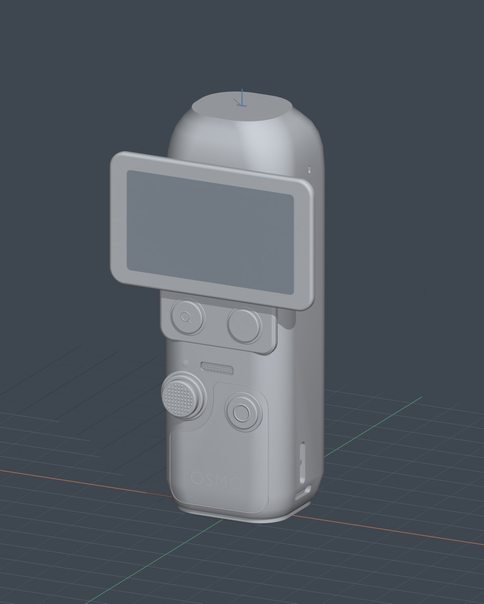

# DJI 口袋云台相机 · 从一句想法到第一版白模

**模拟简报**　“我想做一台能随身带的云台相机。希望有一块能看清取景的屏幕，还没想好是拿在手上用，还是摆在桌上拍。”

下图取自仓库自建的 DJI 口袋云台相机 CG 项目。归档时按 V1 原脚本复演到「机身与横屏组件」，可以看出握把、屏框和按键的位置，头部尚未建立。练习把这张阶段图当作访谈输入。客户简报和后面的回答均为教学模拟。[起模复演记录](https://github.com/AJ-nb/3d-asset-archive/blob/main/projects/pocket-camera/evidence/replay-v1.json)

## 先用什么问题决定下一版

单手行走拍摄时，握感、摇杆位置和拇指能否避开屏幕会改变握把轮廓。放在桌上拍口播时，摄像头朝谁、屏幕从哪里看、充电线如何避开支架更重要。请客户先说一个最常见的拍摄时刻，再圈出阶段图中要保留的部分。已有的横屏外观无法说明转屏轴心与安装方式。

运行[概念工单](products.json)会生成 12 个针对相机的问题。把答复中的方向、原话与仍未知的尺寸记入工单，然后展示[有 DJI 官方来源的参考板](dji-references.md)，请客户按特征选择。只有一句文字输入时可从文字开始，同样适用这套访谈。[访谈方法](../../references/concept-intake.md)

## 把选择落实到装配与画面

> 模拟答复：“主要放在桌上拍我讲话，我选 B。希望坐下就看得到屏幕。桌面支架我会给型号，外壳想要哑光。首图要看得出镜头朝我、屏幕也朝我。”

| 客户的决定或待证事项 | 交给建模、动作与渲染的具体任务 |
| --- | --- |
| **已选 B**，桌面口播 | 先建简化支撑与桌面，按坐姿视线检查取景。用侧视图标注底部接触区、屏中心与镜头中心；待客户提供常用桌高和拍摄距离后再定比例。 |
| **已选** 面向使用者的镜头与可读的屏幕 | 屏幕、机身、支臂与云台头分件，给屏幕和云台分别设轴。记录从收纳到就位的关键帧与中间姿态，逐帧检查最近距离和可见区域。 |
| **待提供** 支架型号 | 接口先保留可编辑的占位体。收到型号和配合尺寸后重查连接、线缆、桌面接触和装拆空间。 |
| **已选** 哑光握把 | 先在中性光里检查机壳倒角、细纹尺度和玻璃反射，再制作桌面主视觉。首图让观众看清镜头、屏幕和着地点。 |

下图用于约定动作验收的拍法。它是同一档案 V7 工程的灰模动作图，展示待机收纳、中立装配、三个单轴动作与组合姿态。图中角度和帧号属于该 CG 工程。新概念须按自己的连接、间隙和限位重新验证。[V7 制作过程索引](https://github.com/AJ-nb/3d-asset-archive/blob/main/projects/pocket-camera/%E5%88%B6%E4%BD%9C%E8%BF%87%E7%A8%8B.md)

交第一版时附同尺度侧视、支承近景和可播放的转屏小样。确认轮廓及尺度后，沿约定基准每 1 mm 取截面，把差异关联到具体零件。实物参考仍缺失的部位在表中留为待证。[逐件检查](../../references/model-review.md) · [截面对比](../../references/sections.md) · [渲染验收](../../references/cmf-stills.md)
