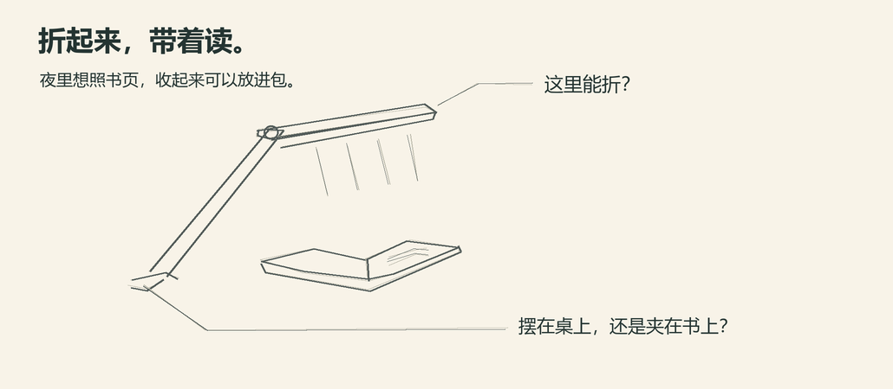
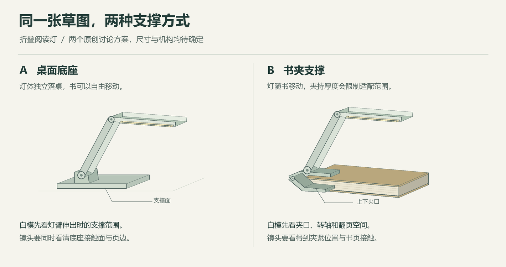

# 一张阅读灯草图，怎样变成第一版白模的任务

这是一份原创教学案例。草图、候选方案、客户回答都用于演示；五个品牌先例各有可查看的官方来源。阅读灯仍处在设计讨论阶段。

## 先厘清图上最重要的歧义

客户的起点是“夜里想照书页，收起来可以放进包”。画面给出了细长灯头、灯臂和一本书。灯臂底端的几笔线可以发展为桌面底座，也可以发展为书夹。图上没有定尺寸，灯头附近的圆圈也还没有确定连接方式。

用[概念工单](products.json)生成这个项目的访谈稿，按编号请客户圈图或回答。可先讨论“换书时要不要挪动灯”“包里哪块空间决定收纳上限”“光要越过书脊还是只落在单页”，再讨论手怎么操作、电源放在哪里、灯是否需要线、希望在什么镜头里看清结果。[访谈题库](../../references/concept-intake.md)

## 给客户实际可选的方向

把这两张示意和[含 5 个官方先例的参考板](lighting-references.md)一起给客户看。先请客户选使用方式，再选想借鉴的局部。比如喜欢 R2 的软垫，可以借鉴其保护接触面的思路，在桌面方案里做防滑脚；选中柔和的发光外观时，扩散片也可以配合两种支撑。讨论图只说明备选关系，销轴、夹力和底座配重留给后续验证。

## 一次模拟答复怎样落到工单

> 我在书桌上看纸书，要能换书，所以选 A。收起来想放在 210 × 150 mm 的夹层里，夹层厚度还要量。喜欢 R3 的窄灯头和 R5 看不见灯珠的感觉。轴怎么做你来提方案。第一张图要看到光落在书页上。

| 决定与依据 | 第一版白模、材质与镜头交接 |
| --- | --- |
| **客户已选** A 桌面支撑，排除夹书。R1 供观察底座与伸展的关系。 | 将底座、灯臂、灯头、销轴分别建件。在同一侧视图记录放置点和伸到远侧页的位置。按质量估计标注重心投影；若要实物打样，另用材料、配重和样机验证抗倾倒。 |
| **客户提供** 夹层可用平面 210 × 150 mm，厚度未知。 | 建独立的包内空间参照框，先对收起状态检查长、宽，厚度留空。请客户量夹层净厚与拉链入口。这个数值只属于模拟客户的夹层。 |
| **已委托设计** 折叠连接。 | 给出销轴与挡止面的侧视草案，标清哪一件固定、哪一件转、线怎么经过轴附近。通过中间姿态和收合状态找碰撞，按确认的设计剖切关键部件。 |
| **已选外观** R3 的细长灯头与 R5 的扩散片效果。 | 将灯壳、发光面和扩散片分件。在中性照明下试灯壳与透光材质，熄灯时看边界，亮灯时查看纸面和可见灯珠。准确照度和眩光指标需另外测量。 |
| **已定首图** 同时看见纸面受光与桌面支撑。 | 采用读者斜前方的镜头，保留灯脚和页边接触。另用同机位的合拢／展开对照说明收纳变化。 |

第一版交给客户看的内容是展开与收起的同尺度白模、连接近景和试光画面。把客户认可的轮廓、接口、尺寸和动作范围保存为设计基准，后续逐件核对倒角、接合、每毫米截面和整段动作，再从同一版模型出正式图。[逐件检查](../../references/model-review.md) · [截面复验](../../references/sections.md) · [渲染验收](../../references/cmf-stills.md)
